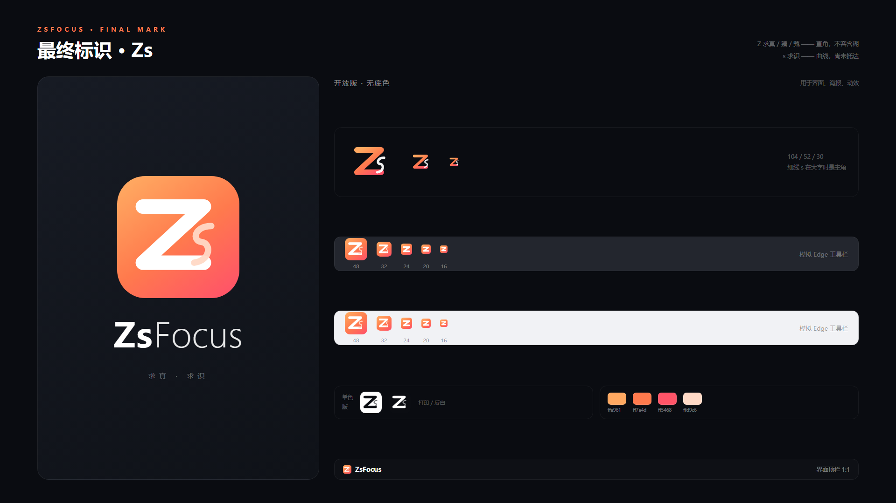

# ZsFocus · 番茄专注

[](LICENSE)


一个装在 Edge（及 Chrome）里的番茄钟：自定义用途分类、实时合成的沉浸音、专注统计报告。**纯原生 HTML / CSS / JavaScript，无框架、无依赖、无构建步骤、无服务器**，数据全部存在本地。

## 它长什么样

点工具栏图标弹出 360×540 的小窗：顶部选用途（学习 / 工作 / 看视频 / 娱乐 / 阅读），中间圆环倒计时，底部一条音乐条。

- **计时**：圆环进度、暂停 / 继续 / 重置 / 跳过；番茄轮次（默认 4 轮后长休息）
- **关掉小窗计时不停**：计时跑在 Service Worker 里，图标上直接显示剩余分钟，暂停显示 `II`
- **沉浸音**：8 种音色全部用 Web Audio 实时合成，没有任何音频文件
  - 氛围：雨声、篝火、溪流、深空
  - 噪音：白噪音、粉红噪音、紫噪音、灰噪音
- **报告**：今日 / 本周 / 本月 / 全部；用途占比环图、每日趋势、24 小时时段分布、连续打卡、CSV 导出

## 安装（约 2 分钟）

不想碰 git 的话，直接下打包好的 **[zsFocus-v1.0.0.zip](https://github.com/1lIlIlIIlIlIl1/focusflow/releases/download/v1.0.0/zsFocus-v1.0.0.zip)**（51 KB），解压后从第 3 步开始。

1. 打开 `edge://extensions`（Chrome 是 `chrome://extensions`）
2. 打开左下角「开发人员模式」
3. 点「加载解压缩的扩展」，选择本仓库的 **`pomodoro-edge`** 文件夹
4. 点工具栏拼图图标 → 找到 ZsFocus → 图钉固定

> ⚠️ 要选 `pomodoro-edge` 这个子文件夹，不是仓库根目录。扩展目录内不能出现任何以 `_` 开头的文件或文件夹，否则浏览器会拒绝加载。

详细使用说明见 [`pomodoro-edge/README.md`](pomodoro-edge/README.md)。

## 仓库结构

```
├── pomodoro-edge/        扩展本体（加载这个文件夹）
│   ├── manifest.json     Manifest V3
│   ├── background.js     计时状态机、闹钟、角标、通知
│   ├── popup.html/js     弹窗界面
│   ├── dashboard.html/js 报告页 + 设置页
│   ├── offscreen.html/js 音频引擎（Web Audio 实时合成）
│   ├── lib/core.js       数据模型、存储、时间与统计
│   ├── styles/           样式
│   └── icons/            图标 16/32/48/128（由 design/logo 渲染）
├── design/logo/          品牌标识工程（Remotion 代码出图）
│   ├── src/brand/        标识组件：4 个方案 + 应用图标
│   ├── src/scenes/       画板与动效：方案对比、最终确认图、logo 动画
│   └── out/              导出的 PNG（512/128/48/32/16）
└── pomodoro-edge-dev/    开发辅助脚本（不进扩展）
    ├── test-core.mjs     统计与时间计算（24 项）
    ├── test-flow.mjs     计时状态机（14 项）
    ├── test-noise.mjs    噪音频谱与预设一致性（56 项）
    └── preview-server.js 把页面当普通网页跑（mock chrome API）
```

## 标识



主体是两个字母：

- **Z —— 求真 / 臻 / 甄**。三个笔画全是直角，代表甄别、去伪存真，容不得含糊。
- **s —— 求识**。一根细线，全是曲线，代表求索、开放、尚且未知。它轻，是因为知识永远没收完。
- **瓦形底**取自「甄」的部首「瓦」——Z 立于瓦上，是「甄」字的结构。

两者重量差就是语义差：真知要重，求知要轻。16px 工具栏尺度下，细线 s 会自然收成一个点，此时它读作一个干净的 Z，仍是完整标识。

标识由代码生成（Remotion + SVG），不是画出来的位图：改一个数字就能重出全部尺寸，也能导出动效视频。

```bash
cd design/logo
npm install
npx remotion still ZsFinal out/zs-final.png --frame=0          # 最终确认图
npx remotion still ZsBoard out/zs-board.png --frame=0          # 四版方案对比
npx remotion still IconCanvas out/icon128.png --frame=0 \
  --props='{"size":128,"variant":"flow","small":false,"icon":true,"dark":false}'
npx remotion render LogoReveal out/logo.mp4                    # 品牌动效
```

## 开发

```bash
cd pomodoro-edge-dev
node test-core.mjs
node test-flow.mjs
node test-noise.mjs
```

## 一些实现决定

- **计时为什么放在 Service Worker**：弹窗一关 DOM 就销毁，计时必须脱离界面；存的是「结束时间戳」而不是剩余秒数，后台被休眠、电脑睡眠都不会算错。
- **音频为什么放在离屏文档**：同理，弹窗关闭后音频要靠 `chrome.offscreen` 继续播放。
- **图表为什么手写 SVG**：扩展 CSP 禁止加载远程脚本，用不了 Chart.js。
- **噪声怎么合成**：白噪音全频段等能量，粉红每倍频程 −3 dB，紫噪 +6 dB（对白噪音做差分），灰噪是白噪音串一组逆等响曲线滤波器。四种都做了 RMS 归一化，切换时响度一致。

## 许可

[MIT](LICENSE) © 2026 1lIlIlIIlIlIl1

标识（`design/logo`）与全部界面代码同样以 MIT 授权。音频不含任何音频文件，全部为 Web Audio 实时合成，无第三方音源版权问题。
